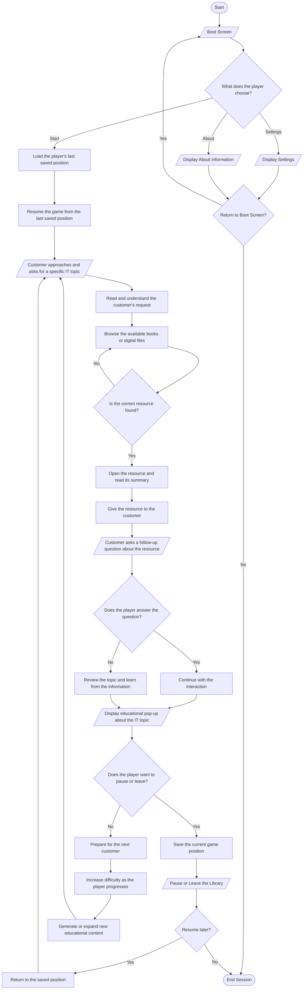

# Version 1

# Tech Library Project Documentation

## 1. Project Overview

### 1.1 Purpose
This document describes the Tech Library project. The Tech Library is an educational simulation game. Players act as IT librarians in a specialized library.

### 1.2 Game Type
- **Genre**: First-Person Educational Simulation
- **Platform**: Web-based application
- **Target**: Desktop/PC browsers only

### 1.3 Player Role
The player acts as an IT librarian. The player manages a library that contains IT resources.

### 1.4 Primary Objective
The player must identify, retrieve, and provide correct informational resources to patrons. Patrons request specific technical information. The player must also learn from the resources to improve technical knowledge.

## 2. System Requirements

### 2.1 Backend Technology
- The system uses C# for the backend only.
- The backend must support web application deployment.

### 2.2 Frontend Technology
- The system can use any technology stack for the frontend.
- The frontend must integrate with C# backend.

### 2.3 Deployment
- The system deploys as a web application.
- The system runs in browsers.
- The system supports desktop/PC browsers only.

### 2.4 Platform Support
- The system runs natively in desktop browsers.
- The system does not support mobile devices.

## 3. Gameplay Mechanics

### 3.1 Core Gameplay Loop
1. A customer approaches the library desk.
2. The customer requests information about a specific IT topic.
3. The player reads and understands the request.
4. The player searches for the correct resource.
5. The player locates the resource and reads the summary.
6. The player gives the resource to the customer.
7. The customer asks a follow-up question.
8. The system displays educational information about the topic.
9. The player learns from the displayed information.
10. The next customer approaches and the cycle repeats.

### 3.2 Resource Categories
The library contains resources in these categories:

| Category | Description | Example Topics |
|----------|-------------|----------------|
| Basic IT | Fundamental computer literacy, hardware identification, basic software usage | Computer basics, hardware components, software installation |
| Computer Systems | Operating systems, system architecture, hardware troubleshooting | Windows, Linux, system maintenance |
| Programming | Core development concepts, paradigms, algorithms | Object-Oriented Programming, data structures, algorithms |
| IT Languages | Syntax, use cases, documentation for specific languages | Python, C++, Java, JavaScript |
| Networking | IP addressing, network topologies, routers, cybersecurity basics | TCP/IP, network configuration, security protocols |
| IT Challenge | Advanced problems for experienced players | System architecture, complex troubleshooting |

### 3.3 Customer Requests
Customers do not request categories. Customers request specific topics within categories. For example:
- A customer may request "Object-Oriented Programming" from the Programming category.
- A customer may request "TCP/IP Protocol" from the Networking category.

### 3.4 Resource Selection
The player uses swipe gestures to browse available resources. The player swipes right to filter through books and digital files. The player selects the resource that matches the customer request.

### 3.5 Educational Component
After the player gives a resource to the customer, the system displays educational information. The information explains the topic clearly. The player reads and learns from this information. This reinforces the player's technical knowledge.

## 4. Game Flow

### 4.1 Flowchart
The following diagram shows the complete game flow:

### 4.2 Boot Screen
The boot screen contains three buttons:
- **Start**: Begins or resumes the game from the last saved position
- **Settings**: Opens the settings menu
- **About**: Displays project information

### 4.3 Settings Menu
The settings menu contains these options:
- Music volume control
- Sound effects volume control
- Text size adjustment
- Swipe sensitivity adjustment

### 4.4 About Section
The about section displays:
- Project information
- Development credits
- Current game version
- Educational intent summary

## 5. Progression Systems

### 5.1 Persistent Session Management
The system saves game progress automatically. When the player clicks "Start", the system loads the last saved position. The player resumes exactly where they left off.

The system includes a Pause and Leave mechanism. The player can pause the game at any time. The player can leave the library for a break. The system saves the current position. When the player returns, the system restores the exact position.

### 5.2 AI-Driven Infinite Gameplay
The game has no end state. An AI system generates new educational content continuously. The AI expands the data within resources. This prevents repetitive requests. The game creates infinite scenarios.

### 5.3 Dynamic Difficulty
The game starts with basic concepts. As the player serves more patrons, the difficulty increases. The content scales toward high-level IT concepts. The content includes architectural challenges for advanced players.

### 5.4 Optional Scoring System
The system includes an optional scoring feature. Players can enable or disable this feature. Players earn points based on:
- Accuracy in answering follow-up questions
- Efficiency in locating resources

## 6. Technical Specifications

### 6.1 Backend Architecture
- The backend uses C# exclusively
- The backend handles game logic
- The backend manages AI content generation
- The backend processes save states

### 6.2 Data Storage
The system stores data in browser storage. The system uses localStorage or IndexedDB. The system does not require a database. The system maintains persistent game states locally.

### 6.3 AI Integration
The system uses AI for content generation. The AI:
- Generates new educational content
- Expands existing resource data
- Creates follow-up questions
- Adapts content to player skill level

### 6.4 Web Application Structure
The system deploys as a web application. The system runs entirely in the browser. The system requires no client-side installation.

## 7. User Interface Elements

### 7.1 Main Interface
The main interface displays:
- Library desk view
- Customer request text prominently displayed
- Book shelf with available resources
- Resource selection area
- Game control buttons

### 7.2 Resource Display
When the player selects a resource, the system shows:
- Resource title
- Resource category
- Brief summary
- Option to give to customer

### 7.3 Educational Popup
The educational popup displays:
- Topic title
- Detailed explanation
- Key concepts
- Continue button

### 7.4 Navigation
The system uses these navigation methods:
- Button clicks for menu navigation
- Swipe gestures for resource browsing
- Back buttons to return to previous screens

## 8. Game States

### 8.1 Boot State
The system displays the boot screen. The player selects Start, Settings, or About.

### 8.2 Game State
The system displays the library desk. The player serves customers. The player manages resources.

### 8.3 Educational State
The system displays the educational popup. The player reads the information. The player learns the topic.

### 8.4 Settings State
The system displays the settings menu. The player adjusts game options.

### 8.5 About State
The system displays project information. The player views credits and version information.

### 8.6 Pause State
The system saves the current position. The system displays the pause menu. The player can resume or exit.

## 9. Save System

### 9.1 Auto-Save
The system saves progress automatically. The system saves when:
- The player gives a resource to a customer
- The player pauses the game
- The player leaves the library

### 9.2 Save Data
The system stores this data:
- Current game position
- Number of customers served
- Current difficulty level
- Completed topics
- Score (if enabled)
- Last played timestamp

### 9.3 Load System
When the player clicks Start, the system:
- Checks for existing save data
- Loads the saved game state
- Restores the player to the exact position
- Displays the last active screen

## 10. Content Generation

### 10.1 Initial Content
The system includes a base set of resources. The resources cover basic IT topics. The resources span all categories.

### 10.2 AI Generation
The AI generates new content continuously. The AI:
- Creates new topic summaries
- Generates follow-up questions
- Expands existing content
- Adapts to player progress

### 10.3 Content Validation
The system validates generated content. The system ensures:
- Technical accuracy
- Appropriate difficulty level
- Clear explanations
- Relevant to player requests

## 11. Accessibility Features

### 11.1 Text Size
The system allows text size adjustment. The player can select Small, Medium, or Large text. This improves readability.

### 11.2 Audio Controls
The system provides separate volume controls for:
- Background music
- Sound effects
The player can adjust each independently.

### 11.3 Swipe Sensitivity
The system allows swipe sensitivity adjustment. The player can customize the gesture responsiveness.

## 12. Performance Requirements

### 12.1 Load Time
The system must load within 3 seconds on standard connections.

### 12.2 Response Time
The system must respond to user input within 100 milliseconds.

### 12.3 Save Time
The system must save game state within 500 milliseconds.

### 12.4 AI Generation Time
The AI must generate content within 2 seconds.

## 13. Browser Compatibility

### 13.1 Supported Browsers
The system supports these desktop browsers:
- Google Chrome (latest version)
- Mozilla Firefox (latest version)
- Microsoft Edge (latest version)
- Safari (latest version)

### 13.2 Required Features
The browser must support:
- JavaScript
- localStorage or IndexedDB
- CSS Grid and Flexbox
- Touch events (for swipe gestures)

## 14. Security Considerations

### 14.1 Data Privacy
The system stores all data locally in the browser. The system does not transmit personal data to external servers.

### 14.2 API Security
The system secures API keys. The system does not expose keys in client-side code. The system uses environment variables for sensitive data.

### 14.3 Content Safety
The AI generates educational content only. The system filters inappropriate content. The system ensures all content is suitable for learning.

## 15. Maintenance and Updates

### 15.1 Content Updates
The system can receive content updates. The updates add new topics. The updates expand categories. The updates improve educational value.

### 15.2 System Updates
The system can receive software updates. The updates fix bugs. The updates improve performance. The updates add features.

### 15.3 AI Model Updates
The system can update AI models. The updates improve content generation. The updates enhance accuracy. The updates expand capabilities.

## 16. Development Guidelines

### 16.1 Code Standards
Developers must follow these standards:
- Use clear variable names
- Write concise functions
- Add comments for complex logic
- Follow consistent formatting

### 16.2 Testing Requirements
Developers must test these areas:
- All user interactions
- Save and load functionality
- AI content generation
- Browser compatibility
- Performance metrics

### 16.3 Documentation
Developers must maintain this documentation. Developers must update the documentation when features change. Developers must ensure accuracy of all information.

## 17. Version History

### 17.1 Current Version
Version 1.0.0 - Initial Release

### 17.2 Planned Features
Future versions may include:
- Additional resource categories
- Multiplayer functionality
- Advanced scoring systems
- Enhanced AI capabilities
- Mobile browser support

## 18. Support and Contact

### 18.1 Technical Support
For technical issues, contact the development team.

### 18.2 Documentation Updates
To suggest documentation improvements, submit a request through the project repository.

### 18.3 Bug Reporting
To report bugs, use the project issue tracker. Provide detailed information about the issue. Include steps to reproduce the bug.

## Appendix A: Glossary

| Term | Definition |
|------|------------|
| NPC | Non-Player Character - A character controlled by the system |
| Patron | A customer who requests information from the library |
| Resource | A book or digital file containing IT information |
| Swipe | A gesture to browse through items on a screen |
| localStorage | A browser feature for storing data locally |
| WebAssembly | A technology that runs code in web browsers at near-native speed |

## Appendix B: Resource Category Details

### B.1 Basic IT
This category covers fundamental concepts. Topics include:
- Computer hardware components
- Basic software operations
- File management
- Internet basics

### B.2 Computer Systems
This category covers system-level topics. Topics include:
- Operating systems
- System architecture
- Hardware troubleshooting
- System maintenance

### B.3 Programming
This category covers development concepts. Topics include:
- Programming paradigms
- Algorithms and data structures
- Software design patterns
- Development methodologies

### B.4 IT Languages
This category covers specific programming languages. Topics include:
- Language syntax
- Language-specific features
- Best practices
- Use cases and applications

### B.5 Networking
This category covers network concepts. Topics include:
- Network protocols
- IP addressing
- Network topologies
- Cybersecurity basics

### B.6 IT Challenge
This category covers advanced topics. Topics include:
- Complex system architecture
- Advanced troubleshooting
- Integration challenges
- Performance optimization